<!-- Perfil de Victor Peçanha · cartões em assets/ gerados pela skill perfil-github -->

 

  

**Forward Deployed Engineer na Dell Anno Atelier: vou até o problema e entrego a solução no ar.**

Next.js, React e TypeScript · Engenharia de Computação na FIAP.

 

<picture>
  <source media="(max-width: 700px)" srcset="assets/papeis-celular.svg" />
  
</picture>

 

 

## 💼 Cases

<picture>
  <source media="(max-width: 700px)" srcset="assets/cases-celular.svg" />
  
</picture>

<b>📖 Problema, solução e resultado de cada case</b>

 

**🏆 Campus Consciente** · equipe DataCore
- **Problema:** monitorar a segurança de um campus em tempo real, reconhecendo quem é cadastrado e quem é intruso, sem depender da nuvem.
- **Solução:** sistema com reconhecimento facial, perfil demográfico, contagem de pessoas e mapa de calor rodando na IA Box da DATEN, com painel web próprio.
- **Resultado:** 1º lugar no AI Vision Edge Challenge do NEXT 2026 (FIAP), em outubro de 2026.
- **Meu papel:** participei do desenvolvimento em equipe de 5 pessoas; fiquei com a frente do dashboard em Next.js.

**🚜 GAVS-6** · projeto em parceria com a John Deere
- **Problema:** produtores precisam de dados do campo para economizar recursos e aumentar o rendimento.
- **Solução:** dispositivo com sensores BME280 e BH1750 que mede as condições do campo e envia via LoRa para uma central, onde são feitos os cálculos de rendimento.
- **Meu papel:** participei do desenvolvimento em equipe.

**📊 Mackenzie** · estágio em front-end
- **Problema:** a plataforma educacional MackEnsina e o backoffice interno precisavam de painéis e conteúdos fáceis de usar no computador e no celular.
- **Solução:** no MackEnsina, dashboard de FAQ com gráficos SVG interativos, indicadores educacionais editáveis, área de Recursos com vídeo e a remodelação do SME Cast; no backoffice, o módulo de e-learning com sub-módulo de BNCC, entregue.
- **Meu papel:** desenvolvi o front-end desses módulos em equipe, de componentes e estados de carregamento à integração com a API.

Fontes: resultado oficial do NEXT 2026 (FIAP), outubro de 2026.

 

## 🧠 Como eu trabalho

<picture>
  <source media="(max-width: 700px)" srcset="assets/metodo-celular.svg" />
  
</picture>

| Dev por demanda | Forward Deployed Engineer |
|:---:|:---:|
| Recebe a tarefa e entrega a tela. | **Vai até o problema e entrega a solução.** |

**Do que eu não abro mão:**

<picture>
  <source media="(max-width: 700px)" srcset="assets/principios-celular.svg" />
  
</picture>

 

## 🛠️ Stack

 

 
 

 

## 📫 Vamos conversar

**Procurando alguém para o seu time de produto?**

Me chama por e-mail, respondo rápido.

 

